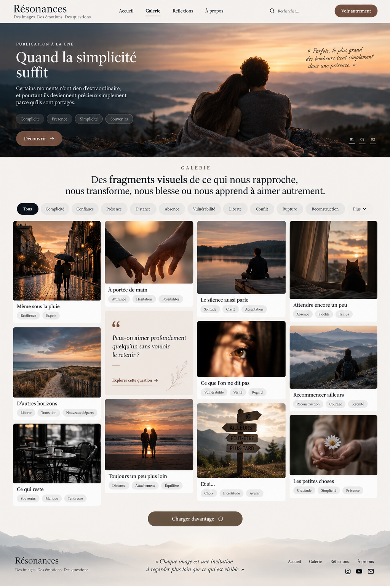

# Résonances — Références de conception visuelle

**Projet :** Résonances V1

**Statut :** Références visuelles indicatives — non contractuelles

**Origine :** Phase initiale « 00 — Conception & architecture »

---

## 1. Objectif du dossier

Ce dossier conserve les premières explorations visuelles de **Résonances**, une plateforme éditoriale francophone consacrée aux représentations de l'amour à travers les images, les émotions, les interprétations et les réflexions.

Ces références permettent de :

- Préserver les intentions artistiques définies lors de la conception initiale.
- Illustrer l'identité visuelle recherchée.
- Orienter les futures implémentations de l'interface.
- Faciliter la compréhension du projet par les développeurs et les agents IA.
- Comparer les futures réalisations aux directions graphiques initiales.

Ces documents ne constituent pas des spécifications techniques définitives.

## 2. Direction artistique

L'identité visuelle de Résonances repose sur quatre principes :

**Minimalisme éditorial**

Une interface sobre, mettant en valeur la lecture et les photographies, avec des espaces généreux et une hiérarchie visuelle claire.

**Photographie cinématographique**

Des images expressives privilégiant les lumières naturelles, les compositions narratives et les atmosphères émotionnelles nuancées.

**Typographie éditoriale**

Une association entre une typographie serif expressive pour les titres et une typographie sans-serif lisible pour les éléments fonctionnels.

Les familles validées pour la V1 sont :

- **Playfair Display** : titres et expressions éditoriales.
- **Inter** : corps des textes, navigation et interface.

**Exploration nuancée de l'amour**

L'expérience visuelle ne doit pas se limiter à une représentation idéalisée de l'amour. Elle peut également évoquer l'absence, la distance, la vulnérabilité, les contradictions, la rupture et la reconstruction.

Le principe éditorial fondateur demeure :

**Voir → Ressentir → Comprendre → Questionner**

## 3. Moodboard éditorial

**Fichier :** `moodboards/resonances-editorial-moodboard.png`

### Description

Ce moodboard rassemble différentes pistes de représentation de l'univers Résonances :

- Une proposition de page d'accueil immersive.
- Un aperçu de Galerie.
- Une proposition de page d'article.
- Une illustration d'espace communautaire futur.
- Des références photographiques.
- Des éléments de palette chromatique et de typographie.

### Utilisation

Il sert principalement de référence pour l'atmosphère générale, la composition photographique, le rythme éditorial et l'identité visuelle.

**Limite importante :** les comptes utilisateurs, espaces communautaires, interactions sociales et autres éléments futurs éventuellement visibles ne font pas partie du périmètre fonctionnel V1.

## 4. Mockup — Galerie V1

**Fichier :** `mockups/resonances-v1-gallery.png`

**Nom historique :** Résonances — Fragments de présence

### Description

Cette maquette présente une exploration détaillée de la page Galerie.

Elle illustre notamment :

- Une publication éditoriale à la une.
- Une photographie principale immersive.
- Une navigation thématique.
- Une grille d'images aux compositions variées.
- Des cartes éditoriales accompagnées de titres et de thèmes.
- Une carte-question intégrée au parcours.
- Un mécanisme de chargement progressif.
- Une composition de bas de page cohérente avec l'identité visuelle.

### Utilisation

Ce mockup constitue une référence privilégiée pour la future conception de la Galerie V1.

L'implémentation devra toutefois respecter les contraintes validées de responsive design, d'accessibilité, de navigation, de pagination et de visibilité des contenus.

Les proportions, espacements, illustrations, textes et placements visibles restent indicatifs tant qu'ils n'ont pas fait l'objet d'une validation détaillée.

## 5. Statut et autorité des références

Les fichiers de ce dossier sont des **supports d'inspiration et de traçabilité historique**.

Ils ne remplacent pas :

1. La spécification fonctionnelle et technique de Résonances V1.
2. Le registre des décisions techniques L0.
3. Les contrats éditoriaux validés.
4. Le design system documenté.
5. Les exigences d'accessibilité et de responsive design.

En cas de divergence, les décisions validées et la documentation maintenue font autorité.

Un élément présent dans une maquette n'est pas automatiquement une fonctionnalité à implémenter.

Inversement, une fonctionnalité validée peut devoir être implémentée même si elle n'apparaît pas dans ces références historiques.

## 6. Frontière V1 et évolutions futures

Résonances V1 est une plateforme éditoriale d'auteur.

Elle inclut notamment la Galerie, les Publications, les Réflexions, les thèmes, les contenus associés et la recherche simple.

Les fonctionnalités suivantes ne doivent pas être déduites des maquettes pour une implémentation V1 :

- Comptes et profils de lecteurs.
- Likes et commentaires.
- Espaces de discussion.
- Notifications.
- Contributions communautaires.
- Personnalisation ou recommandations fondées sur l'IA.

Les explorations visuelles relatives à ces fonctionnalités peuvent être conservées comme références prospectives, sans engagement d'implémentation.

## 7. Images, licences et provenance

### Note de provenance des deux images de ce dossier

Les deux images de ce dossier (`moodboards/resonances-editorial-moodboard.png` et `mockups/resonances-v1-gallery.png`) ont été générées avec ChatGPT (OpenAI) pendant la conception initiale de Résonances.

- Ce sont des références historiques et indicatives.
- Elles ne constituent pas des spécifications fonctionnelles approuvées.
- Elles peuvent représenter des fonctionnalités hors V1 (comptes, likes, commentaires, espace communautaire, notamment).
- Elles ne doivent pas être utilisées directement comme assets de production sans validation supplémentaire.

La date de génération, le modèle exact, les instructions d'origine (prompts) et les conditions de licence applicables ne sont pas documentés dans ce dépôt. Aucune de ces informations n'est supposée ici.

### Règles générales

La présence d'une photographie dans un mockup ne signifie pas qu'elle est automatiquement autorisée pour le site public.

Avant toute réutilisation effective, vérifier :

- L'origine de l'image.
- Les droits de reproduction et de diffusion.
- Les obligations éventuelles d'attribution.
- Les conditions d'utilisation applicables.
- La conformité avec la politique de provenance des médias de Résonances.

Les images générées par IA doivent également faire l'objet de la traçabilité définie dans la spécification.

**La conservation d'un mockup comme référence interne ou publique ne transfère aucun droit sur les visuels qu'il contient.**

## 8. Consignes pour les développeurs et agents IA

Lors de l'implémentation de l'interface :

1. Lire les décisions et spécifications applicables avant d'utiliser ces références.
2. Préserver les intentions artistiques sans reproduire aveuglément les maquettes.
3. Respecter les contraintes techniques et fonctionnelles de la V1.
4. Ne pas ajouter de fonctionnalité simplement parce qu'elle apparaît dans un mockup.
5. Préserver la hiérarchie de lecture et l'accessibilité sur tous les formats d'écran.
6. Éviter toute introduction de dépendance ou de composant non justifié.
7. Signaler les divergences significatives entre maquettes et documentation.
8. Soumettre les nouveaux arbitrages visuels ou fonctionnels à validation.

Ces références peuvent guider les décisions d'interface, mais ne constituent pas une autorisation de modifier le périmètre du projet.

## 9. Évolution du dossier

De nouvelles références pourront être ajoutées à mesure que le projet progressera :

- Variantes de pages.
- Explorations responsive.
- Propositions de composants.
- Études typographiques.
- Comparaisons entre maquettes et interfaces implémentées.

Le dossier doit rester organisé et éviter l'accumulation de variantes redondantes.

Lorsqu'une référence est remplacée ou abandonnée, son statut doit être explicité afin d'éviter toute ambiguïté pour les futurs contributeurs.

---

## Documents associés

- [Spécification Résonances V1](../RESONANCES-V1-SPECIFICATION.md)
- [Décisions techniques L0](../RESONANCES-V1-L0-DECISIONS.md)
- [Contrat éditorial V1](../RESONANCES-V1-EDITORIAL-CONTRACT.md)
- [Instructions pour les agents](../../AGENTS.md)

---

_Ce dossier conserve les intentions visuelles historiques du projet Résonances. Les décisions validées et l'implémentation actuelle demeurent les références pour déterminer ce qui doit effectivement être construit._
